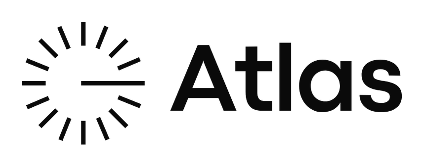

<p align="center">
  <picture>
    <source media="(prefers-color-scheme: dark)" srcset="packaging/branding/atlas-wordmark-dark.png">
    
  </picture>
</p>

<h1 align="center">Atlas Commerce Desktop</h1>

<p align="center"><strong>La plateforme Atlas Commerce, native et rapide.</strong><br>
Un client de bureau léger pour Windows, macOS et Linux, sans moteur de navigateur.</p>

<p align="center">
  <a href="https://github.com/Etherealmber/atlas-commerce-desktop/releases"><strong>Téléchargements</strong></a> ·
  <a href="#fonctionnalités">Fonctionnalités</a> ·
  <a href="#sécurité-et-vie-privée">Sécurité</a> ·
  <a href="#compilation-depuis-les-sources">Compilation</a> ·
  <a href="#mise-à-jour">Mises à jour</a>
</p>

<p align="center">
  <a href="Cargo.toml"></a>
  <a href="https://github.com/Etherealmber/atlas-commerce-desktop/releases"></a>
  <a href="LICENSE"></a>
</p>

Atlas Commerce Desktop est un client natif Rust + [egui](https://www.egui.rs)
construit sur [fastframe](https://fastframe.dev), la même fondation que
ZapFast et Spotifast. Il se connecte à un espace Atlas Commerce — Atlas Cloud
(`https://stock.afmarbre.com`) ou votre propre Worker auto-hébergé — et donne
accès au tableau de bord, au catalogue produits, aux ventes rapides, aux
alertes de stock et à l'agent IA, dans une interface zinc déclinée en thèmes
clair et sombre, en français (avec catalogue anglais inclus).

Aucun moteur de navigateur, aucune télémétrie : tout le réseau passe par
`reqwest` avec rustls, et l'application ne stocke jamais de mot de passe.

## Fonctionnalités

| Fonction | Ce que vous pouvez faire |
|---|---|
| **Démarrage guidé** | Splash, bienvenue, choix du serveur avec sonde `/api/health` en direct, puis connexion. Atlas Cloud est prérempli ; vos serveurs sont enregistrés et oubliables. |
| **Connexion** | Mot de passe + code OTP, lien de vérification par e-mail via `atlascommerce://verify`, ou appairage QR depuis le téléphone (côté PC). |
| **Tableau de bord** | Solde, valeur du stock, compteurs, ventes impayées, activité mensuelle et dernières factures. |
| **Produits** | Recherche, création, seuils de stock et mouvements d'entrée/sortie/ajustement via l'API du Worker. |
| **Ventes** | Historique des factures et ventes rapides (`vente rapide`, sans TVA) avec clé d'idempotence. |
| **Agent IA** | Conversation persistante avec quota et état de blocage issus de `/api/agent/policy`. |
| **Notifications** | Alertes de stock et de factures, pastilles dans la barre latérale et notifications système natives. |
| **Réglages** | Langue, thème sombre/clair/système, zone de notification, démarrage à la connexion, intervalle d'actualisation, serveurs, appareils de confiance et canaux de mise à jour. |
| **Vie du bureau** | Barre de titre personnalisée, zone de notification (`tray`), instance unique, gestion de l'alimentation et liens profonds transmis entre lancements. |
| **Identité visuelle** | Symbole soleil et mot-symbole « Atlas » déclinés automatiquement en clair et en sombre, depuis des masques alpha embarqués ; photo de profil dans la barre de titre avec initiales contrastées en secours. |

## Sécurité et vie privée

- **Empreinte d'appareil** : un SHA-256 dérivé de l'identifiant machine de la
  plateforme (`MachineGuid` sous Windows, `IOPlatformUUID` sur macOS,
  `/etc/machine-id` sous Linux), transmis dans l'en-tête
  `X-Device-Fingerprint`. Le Worker lie chaque session à la paire
  (adresse IP, empreinte).
- **Aucun mot de passe stocké** : seuls le serveur, le nom d'utilisateur et
  le jeton de session sont persistés, dans des fichiers en mode `0600`.
- **En-têtes natifs** : `Authorization: Bearer`, `X-Atlas-Client: native`,
  `Accept: application/json` et un User-Agent non navigateur
  (`Atlas-Desktop/x.y.z (os-arch)`).
- **Reliure de session** : une réponse `401` dont le code n'est pas une erreur
  de saisie (`IP_CHANGED`, `DEVICE_CHANGED`, `UNAUTHORIZED`) force la
  reconnexion ; les erreurs de mot de passe ou d'OTP, elles, conservent la
  session enregistrée.
- **Aucune télémétrie**, aucun analytics, aucun CDN tiers.

## Mise à jour

Les mises à jour passent **exclusivement par les GitHub Releases** de ce
dépôt — jamais par un CDN. Chaque publication contient un actif `update.json`
(`version`, `mandatory`, `minimum_version`, `notes`, `published_at`), les
binaires et un fichier `checksums.txt` (signé Ed25519 lorsque la clé publique
est compilée via `ATLAS_UPDATE_PUBLIC_KEY`).

- Le workflow de publication ne produit que des versions de production
  `x.y.z`, systématiquement promues en *latest* ; aucun canal beta/rc n'est
  publié.
- Une release marquée obligatoire, ou dont la `minimum_version` est supérieure
  à la version installée, affiche un écran de mise à jour bloquant.
- Le téléchargement, la vérification de somme de contrôle, l'installation par
  assistant et la restauration automatique en cas d'échec sont gérés par
  `fastframe-update`.

## Session et verrouillage

La perte de focus, la réduction et la fermeture dans la zone de notification
mettent fin à la session locale et demandent une authentification par mot de
passe à la réouverture. Les sessions enregistrées ne sont pas restaurées
sans authentification au lancement. Aucun mot de passe n'est conservé. Une
connexion peut aussi demander le code de vérification du serveur.

Le QR reste disponible pour une première connexion. Le client natif ne
présente pas de défi Turnstile : le contrat actuel du Worker dispense les
requêtes natives de ce défi. Les passkeys et une durée de session choisie par
l'utilisateur ne sont pas prises en charge par ce client.

## Compilation depuis les sources

Prérequis : Rust 1.98 ou supérieur (le dépôt épingle la version exacte dans
`rust-toolchain.toml`), et les bibliothèques graphiques habituelles d'egui
(OpenGL/EGL, X11/Wayland, xkbcommon).

```sh
git clone https://github.com/Etherealmber/atlas-commerce-desktop
cd atlas-commerce-desktop
cargo build --release
cargo test --workspace
```

L'exécutable produit est `target/release/atlas-commerce-desktop`.

Le dépôt est un espace de travail Cargo divisé en quatre crates :

| Crate | Rôle |
|---|---|
| `atlas-core` | Empreinte d'appareil, dossiers, serveurs, sessions, réglages, liens profonds, tâches asynchrones, manifeste de mise à jour. |
| `atlas-api` | Client HTTP rustls du Worker : enveloppes `{success, data, meta}`, authentification, QR, produits, ventes, agent. |
| `atlas-ui` | Interface egui/fastframe : écrans, thèmes, i18n, zone de notification, dialogue avec le Worker. |
| `atlas-commerce-desktop` (binaire) | Point d'entrée : instance unique, interception des mises à jour, liens `atlascommerce://`, alimentation et fenêtre. |

Les dépendances ne viennent que de crates.io et des dépôts `crmne`
(fastframe et le fork egui, tous deux épinglés dans `Cargo.toml`).

## Internationalisation

L'anglais est la langue source et le repli ; le français est la langue par
défaut, livré sous forme de catalogue gettext compilé au build
(`crates/ui/assets/i18n/fr.po`). Pour régénérer les chaînes après
modification de l'interface :

```sh
./scripts/update-translations.sh
```

## Paquets et publication

Voir [PACKAGING.md](PACKAGING.md) pour le détail de l'installeur Windows
universel Inno Setup (un seul `setup.exe` pour x64 et ARM64), du bundle
macOS universel (lipo, DMG, signature conditionnelle), des paquets Linux
(AppImage + zsync, deb, rpm) et des workflows GitHub Actions (`ci.yml`,
`release.yml`, `packaging.yml`, `ci-bot.yml`, `dependabot.yml`).

## Identité de marque et icônes

Le logo est le symbole soleil accompagné du mot-symbole « Atlas ». Deux
variantes sont fournies : encre noire sur fond blanc et encre blanche sur
fond noir.

- `crates/ui/assets/branding/atlas-mark.mask` et `atlas-wordmark.mask` :
  masques de couverture 8 bits (en-tête `u32` largeur, `u32` hauteur, puis
  un octet de couverture par pixel) embarqués dans le binaire. L'interface
  les teinte avec le jeton `accent` du thème actif, sans décodeur d'image à
  l'exécution.
- `packaging/branding/atlas-wordmark-light.png` et
  `atlas-wordmark-dark.png` : versions PNG pour la documentation.
- `packaging/icons/atlas-commerce-desktop.svg`,
  `packaging/macos/icon-1024.png` et
  `packaging/windows/atlas-commerce-desktop.ico` : icône applicative
  (tuile noir mat `#0a0a0a` et symbole papier `#fafafa`).

Tous ces fichiers se régénèrent depuis les masques avec :

```sh
python3 scripts/generate-icons.py   # Pillow requis
```

## Remerciements

Atlas Commerce Desktop s'appuie sur
[egui](https://www.egui.rs), [fastframe](https://fastframe.dev),
[reqwest](https://crates.io/crates/reqwest), les icônes
[Lucide](https://lucide.dev) (ISC), les polices DM Sans et Spline Sans Mono
(OFL) et le logo Atlas fourni par le projet (voir `packaging/branding/`).

## Licence

MIT © 2026 loxdpsy/Etherealmber — voir [LICENSE](LICENSE).
